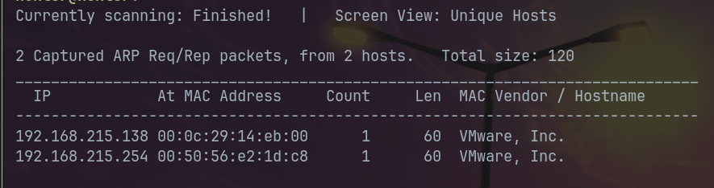
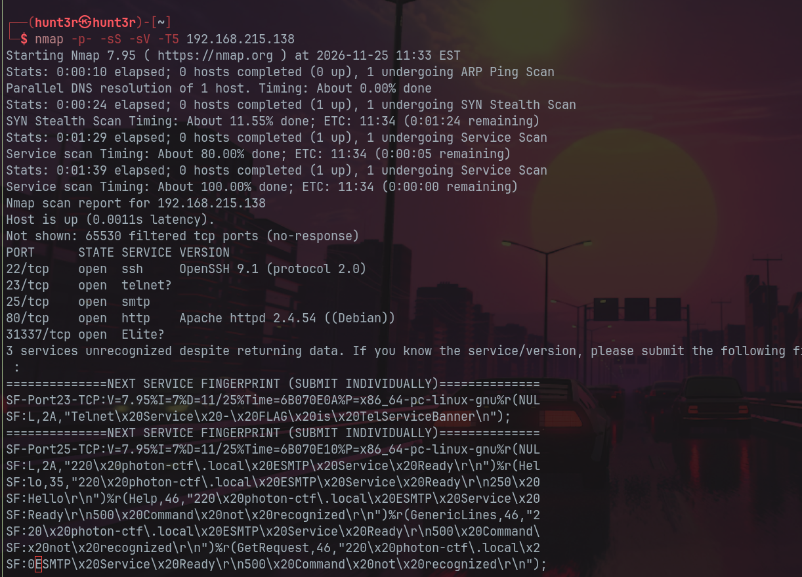
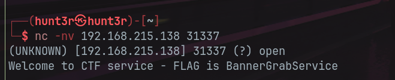
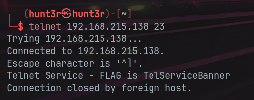
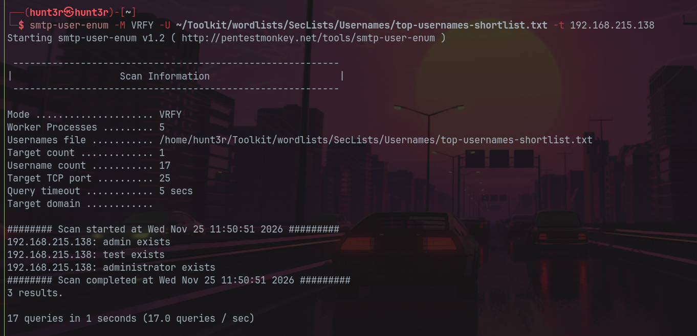
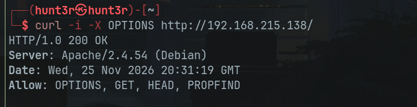

# Challenge Overview

| Platform & Name | Challenginno / NamAvar-Competition-lab01 |
| --------------- | ---------------------------------------- |
| Date            | 2026-11-25                               |
| Solver          | ph4nt01                                  |
| 🔰 Category     | Network / Web / Web-Recon                |
| ⭐ Difficulty    | Medium                                   |
| 🎯 Points       | 8                                        |

---

# Initial Info


1. Enter the flag located on the server’s non-standard port. (2 points)
2. Enter the flag associated with the Telnet service. (2 points)
3. Enter the list of three users on the mail server according to the guide. (2 points)
4. Upload a text file to the web server so that the web server flag is displayed. (2 points)

---

# Initial Analysis

First i ran the command `netdiscover` to find out the IP of the target:


Then i ran `nmap -p- -sS -sV -T5` on the target to see what is running on its ports and perform service discovery on the target:

> `-p-` Scans all ports of the target

> `-sS` Performs a TCP SYN scan; sends a SYN packet but does not compelte the TCP handshake which makes it faster and stealthier

> `-sV` Performs service and version detection

> `-T5` This is the most aggressive speed settings (minimal delays between scans), this makes the scan fast but can lower accuracy on slow networks (not recommended in real world enviroments)

As we see there is a few ports we can investigate further

---

# Solving

First I tried the unusual port `31337` and attempted to connect to it manually via netcat command `nc -nv` and it gave me the first flag immediately:


> `-n` Skips DNS resolution which makes the connecting process a little faster
> `-v` Shows connection details

Then i tried connecting to port `23` which nmap told us that its running telnet, and it was in fact running telnet and gave me the next flag as soon as i connect to it via `telnet` command:


For the next flag objective (users on mail server), i tried enumerating SMTP and finding the users with `smtp-user-enum -M VRFY -U ~/top-usernames.txt -t <target-ip>` command:

> `-M VRFY` Sets the enumeration method to `VRFY`; tells the server to verify if a user exist or not
> `-U jasem.txt` Gives the tool the path to username wordlist for enumeration
> `t <target-IP>` Gives the tool the target IP

To upload a file to the target server (which is the objective for the next flag) i did the below actions:

- First i created a test file, Then i tried uploading that file via `curl` and `POST` `PUT` methods and it was unsuccessful:

```sh
touch test.txt && echo "jasem" > test.txt

curl -i -T test.txt http://192.168.215.138
HTTP/1.0 403 Forbidden
Server: Apache/2.4.54 (Debian)
Date: Thu, 26 Nov 2026 13:39:40 GMT

403 Forbidden

curl -i -X POST test.txt http://192.168.215.138 -F "file=@test.txt"
curl: (6) Could not resolve host: test.txt
HTTP/1.0 501 Unsupported method ('POST')
Server: Apache/2.4.54 (Debian)
Date: Thu, 26 Nov 2026 13:49:29 GMT
Connection: close
Content-Type: text/html;charset=utf-8
Content-Length: 357

<!DOCTYPE HTML>
<html lang="en">
    <head>
        <meta charset="utf-8">
        <title>Error response</title>
    </head>
    <body>
        <h1>Error response</h1>
        <p>Error code: 501</p>
        <p>Message: Unsupported method ('POST').</p>
        <p>Error code explanation: 501 - Server does not support this operation.</p>
    </body>
</html>
```

> `-i` Tells curl to include the HTTP response headers in the output (shows status codes, server type, etc.).
> `-T` Uploads the file to the target URL using `PUT` method
> `-X` Tells curl to use specified HTTP method
> `-F` Gives curl the file path

- Then I ran `curl -i -X OPTIONS` to see what methods does it actually allow:

- As we can see there is no `POST` or `PUT` method in the allow list here for us to be able to upload a file
- After researching about the `PROPFIND` http method and trying it out i found out that it is not supported by the server although `OPTIONS` says otherwise

- Then i ran `dirb` command to find the right directory which supports `PUT` or `POST` for us to upload the file:

```sh
dirb http://192.168.215.138/ /usr/share/wordlists/dirb/common.txt
-----------------
DIRB v2.22
By The Dark Raver
-----------------
START_TIME: Wed Nov 25 12:01:35 2026
URL_BASE: http://192.168.215.138/
WORDLIST_FILES: /usr/share/wordlists/dirb/common.txt
-----------------
GENERATED WORDS: 4612
---Scanning URL: http://192.168.215.138/ ----
+ http://192.168.215.138/css (CODE:301|SIZE:0)
+ http://192.168.215.138/images (CODE:301|SIZE:0)
+ http://192.168.215.138/index.html (CODE:200|SIZE:2450)
+ http://192.168.215.138/js (CODE:301|SIZE:0)
+ http://192.168.215.138/upload (CODE:301|SIZE:0)
-----------------
END_TIME: Wed Nov 25 12:02:02 2026
DOWNLOADED: 4612 FOUND: 5

curl -i -X OPTIONS http://192.168.215.138/upload
HTTP/1.0 200 OK
Server: Apache/2.4.54 (Debian)
Date: Thu, 26 Nov 2026 14:13:55 GMT
Allow: OPTIONS, GET, HEAD, PUT
```

- And after finding the right directory i uploaded the file and it was successful but it did not gave me the flag for objective 4 of the challenge...:

```sh
curl -i -T test.txt http://192.168.215.138/upload/
HTTP/1.0 201 Created
Server: Apache/2.4.54 (Debian)
Date: Thu, 26 Nov 2026 14:14:27 GMT

File uploaded.

curl -i http://192.168.215.138/upload/test.txt
HTTP/1.0 200 OK
Server: Apache/2.4.54 (Debian)
Date: Thu, 26 Nov 2026 14:14:59 GMT
Content-type: text/plain
Content-Length: 6
Last-Modified: Thu, 26 Nov 2026 14:14:27 GMT

jasem
```

- After trying a bunch of times and failing, i found out that the `flag.txt` was already there and there was no need for the file upload at all:

```sh
curl -i http://192.168.215.138/upload/
HTTP/1.0 200 OK
Server: Apache/2.4.54 (Debian)
Date: Thu, 26 Nov 2026 14:24:35 GMT
Content-type: text/html; charset=utf-8
Content-Length: 283

<!DOCTYPE HTML>
<html lang="en">
<head>
<meta charset="utf-8">
<title>Directory listing for /upload/</title>
</head>
<body>
<h1>Directory listing for /upload/</h1>
<hr>
<ul>
<li><a href="flag.txt">flag.txt</a></li>
<li><a href="test.txt">test.txt</a></li>
</ul>
<hr>
</body>
</html>

curl -i http://192.168.215.138/upload/flag.txt
HTTP/1.0 200 OK
Server: Apache/2.4.54 (Debian)
Date: Wed, 25 Nov 2026 20:55:21 GMT
Content-type: text/plain
Content-Length: 22
Last-Modified: Wed, 25 Nov 2026 20:55:11 GMT
WebserverFlag-Scanning
```

---

# Takeaways

- Never assume a method is actually supported just because it appears in the `Allow` header.
- `dirb` is a useful tool for directory enumeration of the target web server; always run it in this kind of challenges
- You can do alot with `curl`

---
