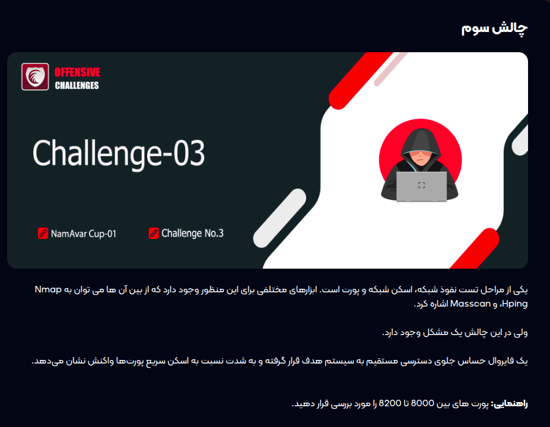
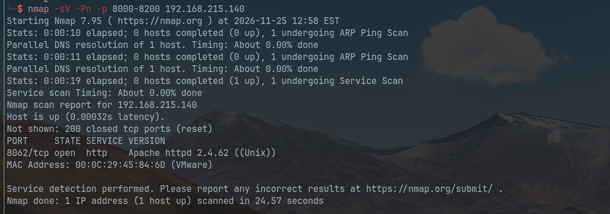
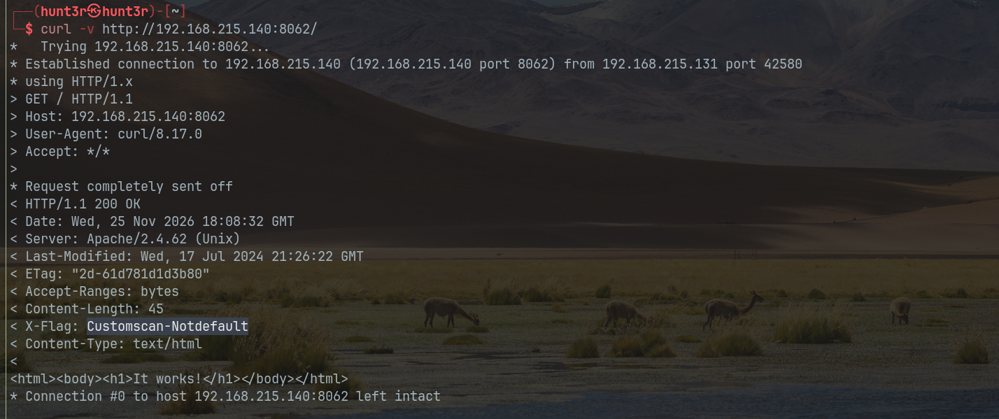

# Challenge Overview

| Platform & Name | Challenginno / NamAvar-Competition-lab01 |
| --------------- | ---------------------------------------- |
| Date            | 2026-11-25                               |
| Solver          | ph4nt01                                  |
| 🔰 Category     | Network / Web                            |
| ⭐ Difficulty    | Easy                                  |
| 🎯 Points       | 5                                        |

---

# Initial Info

1. After identifying the port and sending a request to it, find the flag value. (5 points)

---

# Initial Analysis

First i ran `nmap -p 8000-8200` to find the target service and port for the flag objective

---

# Solving

After that i found the flag via sending a simple `GET` request via `curl` to the target server

---

# Takeaways

- Always checkout the HTTP headers, there may be something intersting there

---

