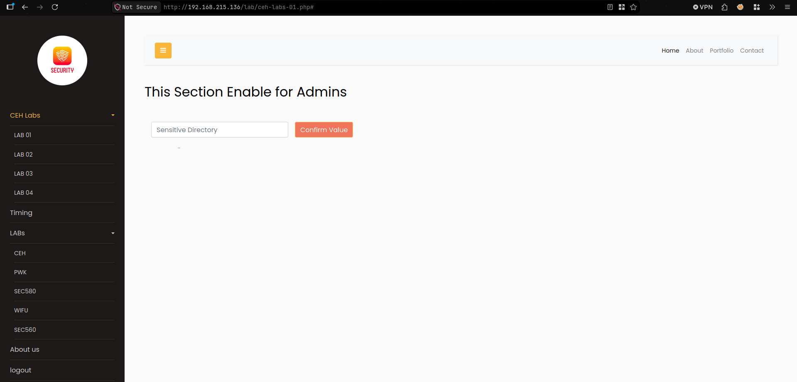
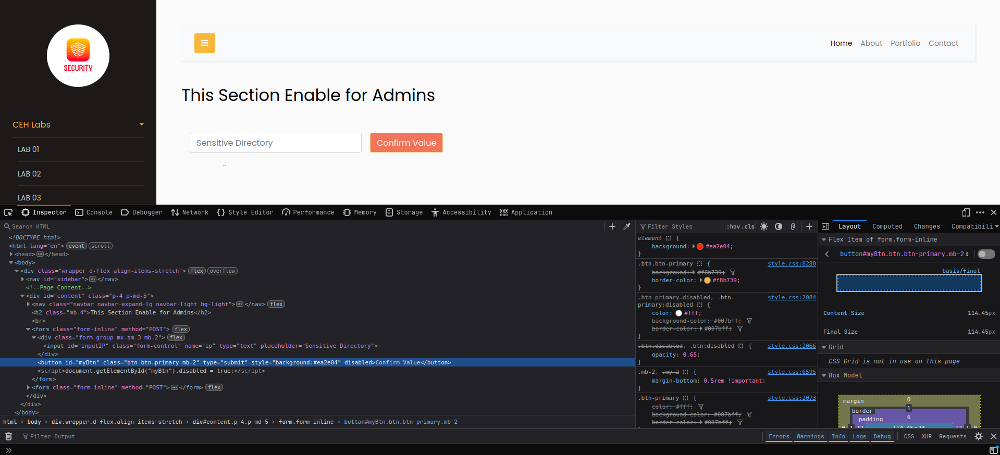

# 📌 Challenge Overview

| 🧩 Platform & Name | Challenginno / WebApp-Recon |
| ------------------ | --------------------------- |
| 📅 Date | 2026-11-22 |
| 👾 Solver | ph4nt01 |
| 🔰 Category | Web / Recon |
| ⭐ Difficulty | Medium |
| 🎯 Points | 22 |

---

# 📋 Initial Info

## Challenge Overview

One of the most important phases of web penetration testing is information gathering, also known as **Reconnaissance (Recon)**.

In this challenge, we analyze and investigate a website in a controlled lab environment. Using reconnaissance and network scanning tools, we first discover the target's overall structure and then analyze its directories, files, and server technologies to identify potential vulnerabilities and exposed information.

### Objectives

Throughout this challenge, we are expected to perform the following tasks:

**1. Reconnaissance and Mapping**

Identify the network infrastructure and active services running on the target server using standard penetration testing tools. Discover hidden and accessible directories.

**2. Detailed Analysis**

Examine source code, configuration files, and discovered databases to identify sensitive information, such as usernames and passwords, that could help us gain access to restricted areas.

**3. Client-Side Security Assessment**

Analyze client-side code to bypass restrictions imposed by the user interface and enable disabled functionality for further interaction with the application.

**4. Data Extraction**

Combine the gathered information with successful access to restricted areas of the application to retrieve the final flag and complete the challenge.

This challenge provides an opportunity to practice standard web penetration testing methodologies and understand how client-side security controls can be bypassed.

### Challenge Questions

The challenge consists of nine questions:

1. **Web Server Path (2 Points)**

   What is the name of the path under which the web server is accessible? (The URL-visible path is required, not the actual filesystem path. For example: `test`.)

2. **Programming Language and Version (2 Points)**

   What is the name and version of the programming language being used? (Example: `asp-4.23.1`)

3. **Web Server and Version (2 Points)**

   What is the name and version of the web server being used? (Example: `nginx-1.181`)

4. **libPNG Version (2 Points)**

   What is the version of `libPNG`?

5. **Login Page (2 Points)**

   What is the name of the application's login page?

6. **Important Directory (2 Points)**

   What is the important directory (path) present in the application?

7. **User Credentials (2 Points)**

   Provide one username along with its corresponding password. (Example: `ahmad-Aa123456`)

8. **Administrator Password (4 Points)**

   What is the password of the administrator account? (This information is not available in the database.)

9. **Final Flag (4 Points)**

   What is the final flag obtained after logging in?

---

# 🔍 Initial Analysis

### 1. Port Scanning and Service Identification

First, I used Nmap to identify the open ports and services running on the target machine.

```bash
nmap -p- -sS -sV -T5 192.168.215.136
```

```text
└─$ nmap -p- -sS -sV -T5 192.168.215.136
Starting Nmap 7.95 ( https://nmap.org ) at 2026-11-22 14:18 EST
Nmap scan report for 192.168.215.136
Host is up (0.0016s latency).
Not shown: 65532 filtered tcp ports (no-response)
PORT     STATE SERVICE VERSION
22/tcp   open  ssh     OpenSSH 9.1 (protocol 2.0)
80/tcp   open  http    xxxxxxxxxxxx ((Ubuntu))
3306/tcp open  mysql   MariaDB 5.5.5-10.1.43
MAC Address: 00:0C:29:EC:1E:43 (VMware)
Service detection performed. Please report any incorrect results at https://nmap.org/submit/ .
Nmap done: 1 IP address (1 host up) scanned in 79.24 seconds
```

As we can see, the target is running `xxxxx` with the identified version.

<badge>Flag 3</badge> **The web server name and version were identified through Nmap service detection.**

### 2. Initial Website Inspection

Next, I opened the target IP address in my browser to see what was being served.

However, the homepage was completely blank and did not reveal any useful information.

Since there was nothing interesting to inspect on the homepage, I moved on to directory enumeration.

### 3. Directory Enumeration

I used DIRB to discover accessible directories and files:

```bash
dirb http://192.168.215.136
```

The scan revealed the main web application directory.

<badge>Flag 1</badge> **The first flag was discovered by identifying the URL-visible directory path: `/xxx`.**

I then visited the discovered directory:

```text
http://192.168.215.136/xxx
```

This revealed the actual web application, giving us a starting point for further enumeration.

---

# 🔓 Solving

## 1. PHP File Enumeration

After discovering the application directory, I proceeded to enumerate PHP files.

Since the application appeared to be PHP-based, I ran DIRB again with the `-X .php` option to search specifically for files with the `.php` extension.

```bash
dirb http://192.168.215.136/xxx/ -X .php
```

```text
└─$ dirb http://192.168.215.136/xxx/ -X .php
-----------------
DIRB v2.22
By The Dark Raver
-----------------
START_TIME: Sun Nov 22 15:09:09 2026
URL_BASE: http://192.168.215.136/xxx/
WORDLIST_FILES: /usr/share/dirb/wordlists/common.txt
EXTENSIONS_LIST: (.php) | (.php) [NUM = 1]
-----------------
GENERATED WORDS: 4612
---- Scanning URL: http://192.168.215.136/lab/ ----
+xxxxxxxxx...
-----------------
END_TIME: Sun Nov 22 15:09:25 2026
DOWNLOADED: 4612 - FOUND: 7
```

I inspected the discovered files individually. One of them was an information page that exposed the exact PHP version and the installed `libPNG` version.

<badge>Flag 2</badge> **The PHP version was obtained from the discovered information page.**

<badge>Flag 4</badge> **The libPNG version was also exposed on the same information page.**

Two other accessible files were related to the application's login functionality.

<badge>Flag 5</badge> **The application's login page was discovered during PHP file enumeration.**

## 2. TXT File Enumeration and Directory Discovery

Next, I searched for exposed text files by running DIRB with the `.txt` extension:

```bash
dirb http://192.168.215.136/xxx/ -X .txt
```

After examining the discovered results, I found an interesting page containing several additional paths and links.

I followed those paths and investigated the accessible resources. Only one of the interesting paths appeared to contain an accessible resource.

<badge>Flag 6</badge> **The important directory was discovered by following the paths exposed on the TXT-related page.**

Inside this directory, I found a file named `lab.sql`. I downloaded it for further inspection.

## 3. Extracting Credentials from the SQL Dump

After downloading and inspecting `lab.sql`, I found several usernames and their corresponding passwords.

These credentials were stored in the exposed SQL dump and could be used to authenticate to the application.

<badge color="success">Flag 7</badge> **The username and password were obtained from the exposed `lab.sql` database dump.**

I used these credentials to successfully log in to the application.

## 4. Discovering the Administrator Password

The challenge explicitly mentioned that the administrator password was not stored in the database.

Therefore, I needed to investigate other exposed files, particularly backup files that might contain older versions of the application's source code.

I used FFUF to search for files ending in `.php.bak`:

```bash
ffuf -u http://192.168.215.136/xxx/FUZZ.php.bak \
-w /usr/share/dirb/wordlists/big.txt
```

```text
└─$ ffuf -u http://192.168.215.136/xxx/FUZZ.php.bak -w /usr/share/dirb/wordlists/big.txt
        /'___\  /'___\           /'___\
       /\ \__/ /\ \__/  __  __  /\ \__/
       \ \ ,__\\ \ ,__\/\ \/\ \ \ \ ,__\
        \ \ \_/ \ \ \_/\ \ \_\ \ \ \_/
         \ \_\   \ \_\  \ \____/  \/_/
          \/_/    \/_/   \/___/    \/_/

       v2.1.0-dev
________________________________________________

 :: Method           : GET
 :: URL              : http://192.168.215.136/lab/FUZZ.php.bak
 :: Wordlist         : FUZZ: /usr/share/dirb/wordlists/big.txt
 :: Follow redirects : false
 :: Calibration      : false
 :: Timeout          : 10
 :: Threads          : 40
 :: Matcher          : Response status: 200-299,301,302,307,401,403,405,500
________________________________________________

.htaccess               [Status: 403, Size: 280, Words: 20, Lines: 10, Duration: 15ms]
.htpasswd               [Status: 403, Size: 280, Words: 20, Lines: 10, Duration: 16ms]
xxxxx                   [Status: 200, Size: 6557, Words: 1249, Lines: 130, Duration: 3ms]

:: Progress: [20469/20469] :: Job [1/1] :: 925 req/sec :: Duration: [0:00:07] :: Errors: 0 ::
```

One of the discovered files was accessible and automatically downloaded when I visited its URL.

After inspecting it, I found an interesting section containing the administrator's credentials.

```bash
cat xxxxx.php.bak | grep admin
```

Output:

```php
#if ($user == "admin" && $pwd == "xxxxxx") {
```

<badge color="success">Flag 8</badge> **The administrator password was discovered inside the exposed `login.php.bak` backup file: `xxxxxx`.**

Initially, I tried using these credentials on the login page, but authentication failed.

After examining the code more carefully, I noticed the `#` character at the beginning of the condition. In PHP, this character comments out the entire line, meaning that this older administrator authentication condition is not executed.

The active authentication mechanism checks the submitted username and password against the database. Since the SQL dump did not contain an administrator account, the discovered password could not be used to authenticate through this login mechanism.

Nevertheless, the password was accepted by the CTF platform as the correct answer to Question 8.

## 5. Retrieving the Final Flag

To find the final flag, I continued investigating the application using the valid user credentials discovered earlier.

After logging in as `xxxx`, I navigated to the previously discovered application page:

```text
/xxx/xxx-xxx.php
```

In the sidebar, I noticed an option named **LAB 01**. After clicking it, the following page appeared:



The page asked us to enter the sensitive directory path discovered earlier (Flag 6).

However, the **Confirm Value** button was disabled.

### Bypassing the Client-Side Restriction

I opened the browser Developer Tools and inspected the page's HTML to understand why the button was disabled.

After examining the element, I found the `disabled` attribute responsible for preventing interaction with the button.



I removed the `disabled` attribute from the button through Developer Tools, which enabled it.

The button's appearance changed, indicating that it was now interactive.

I then entered the sensitive directory name discovered earlier and clicked **Confirm Value**.

<badge color="success">Flag 9</badge> **The final flag was displayed after removing the button's client-side disabled restriction and submitting the correct directory name.**

The challenge was successfully completed!

---

# 📚 Takeaways

- A blank homepage does not necessarily mean there is nothing interesting on the web server. Directory and file enumeration can reveal hidden application paths and exposed resources.

- **Technology fingerprinting** with tools like WhatWeb and Nmap helps identify the web server and its version, while inspecting exposed information pages can reveal additional details such as PHP and library versions.

- Directory and file enumeration should include different extensions. Searching for `.php`, `.txt`, `.bak`, `.old`, `.zip`, and `.rar` files can uncover resources that are not linked anywhere in the application.

- Exposed backup files and database dumps can lead to serious information disclosure. In this challenge, the SQL dump contained valid user credentials, while a backup PHP file revealed the administrator password.

- **Never trust client-side restrictions as security controls.** HTML attributes such as `disabled` can be modified through browser Developer Tools. Sensitive operations must always be validated and authorized on the server side.

- Understanding the application's authentication logic is important. A password found in a backup file does not necessarily mean it is accepted by the active authentication mechanism. Always inspect how the application actually verifies credentials.

- Outdated software versions are worth investigating, but they do not automatically mean that exploiting the web server is the best approach. Understanding the challenge objectives and following a structured reconnaissance methodology can be much more effective than immediately attempting to obtain a shell.

- Finally, information gathered during reconnaissance often becomes the foundation for further exploitation. Small discoveries, such as an exposed directory or backup file, can eventually lead to credentials and access to restricted application functionality.
